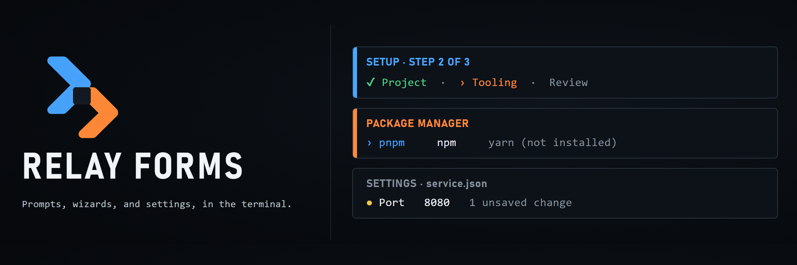

<p align="center">
  
</p>

Relay Forms builds the setup flows of command-line tools: single prompts, multi-step wizards, and editors for configuration files. Forms render in the normal terminal rather than a full screen, so the answers stay in the scrollback after the flow finishes.

## Try the demo

```sh
npm install
npm run demo
```

The demo asks the questions of a project setup flow and prints the answers. It writes nothing to disk. Two more demonstrations show the other parts of the package:

```sh
npm run demo -- wizard
npm run demo -- config
```

`wizard` splits the same flow into steps with a review screen, and `config` opens a sample settings document in the configuration editor. Add `--snapshot` to print the first screen of any demonstration and exit.

## Ask questions

`askAll` asks a list of fields in order and resolves with the answers, keyed by field name. Answered questions stay in the terminal as a summary, and Esc returns to the previous question.

```ts
import {FormCancelledError, askAll, defineFields} from '@relay-cli/forms';

const fields = defineFields([
  {kind: 'text', name: 'name', label: 'Project name', required: true},
  {
    kind: 'select',
    name: 'packageManager',
    label: 'Package manager',
    options: [{value: 'npm'}, {value: 'pnpm'}],
  },
  {kind: 'text', name: 'token', label: 'Registry token', mask: true},
  {kind: 'confirm', name: 'git', label: 'Initialize a git repository?', initial: true},
]);

try {
  const answers = await askAll(fields);
  // answers.packageManager is typed as 'npm' | 'pnpm'
} catch (error) {
  if (error instanceof FormCancelledError) process.exitCode = 130;
  else throw error;
}
```

`ask` asks a single field. Fields can be `text`, `number`, `confirm`, `select`, or `multiselect`, and each can validate its answer, including with an asynchronous check. See [the prompt guide](./docs/prompts.md).

## Multi-step wizards

`runWizard` groups fields into steps. Steps can depend on earlier answers, Esc moves back through questions and steps, and a review screen lets the person change any step before the wizard resolves.

```ts
import {runWizard} from '@relay-cli/forms';

const answers = await runWizard(
  [
    {id: 'project', title: 'Project', fields: [nameField, kindField]},
    {id: 'service', title: 'Service', when: (a) => a.kind === 'service', fields: [portField]},
    {id: 'publish', title: 'Publish', fields: [tokenField, gitField]},
  ],
  {title: 'Create a project'},
);
```

Run `npm run demo -- wizard` to try it. See [the wizard guide](./docs/wizard.md).

## Configuration editors

`editConfig` opens a JSON configuration file as a list of settings, edits each one with the prompt for its field, and writes the file only when the person saves. Dotted names edit nested values, and keys without a field are preserved.

```ts
import {editConfig} from '@relay-cli/forms';

const {saved, changes} = await editConfig('./service.json', [
  {kind: 'text', name: 'name', label: 'Service name', required: true},
  {kind: 'number', name: 'server.port', label: 'Port', initial: 3000, min: 1, max: 65535},
  {kind: 'text', name: 'token', label: 'API token', mask: true},
]);
```

Run `npm run demo -- config` to try it on a sample document. See [the configuration editor guide](./docs/config-editor.md).

## Keys

| Key      | Action                                                      |
| -------- | ----------------------------------------------------------- |
| `Enter`  | Accept the answer, or edit the selected setting             |
| `Escape` | Return to the previous question, or cancel at the first one |
| `↑`, `↓` | Move through options, or between settings                   |
| `Space`  | Toggle an option in a multiple choice                       |
| `y`, `n` | Answer a confirmation                                       |
| `s`      | Save the configuration editor                               |
| `q`      | Leave the configuration editor, confirming unsaved changes  |
| `Ctrl+C` | Cancel the form                                             |

Text fields also accept `Ctrl+A`, `Ctrl+E`, `Ctrl+U`, `Ctrl+K`, and `Ctrl+W`. The complete list for each field kind is in [the prompt guide](./docs/prompts.md).

## Build your own form

`runForm` renders any Ink component where the cursor is and resolves with the value the component submits. Ctrl+C cancels it, and `runForm` then rejects with `FormCancelledError`. `Prompt`, `PromptList`, and `FormFrame` are ordinary components, so they can be combined with your own.

```tsx
import {FormFrame, PromptList, runForm} from '@relay-cli/forms';

const answers = await runForm<Record<string, unknown>>(({submit, cancel}) => (
  <FormFrame title="Deploy">
    <PromptList fields={fields} onSubmit={submit} onCancel={cancel} />
  </FormFrame>
));
```

## Documentation

- [Prompts](./docs/prompts.md)
- [Wizards](./docs/wizard.md)
- [Configuration editor](./docs/config-editor.md)
- [Architecture](./docs/architecture.md)

## Scope

This release covers questions asked while a tool is set up or reconfigured. Full-screen layouts belong in Relay Shell, and the configuration editor reads and writes JSON files.

## Development

```sh
npm install
npm run check
```

`npm run check` verifies formatting, linting, strict types, tests, and the distributable package. Relay Forms requires Node.js 22 or newer. See [CONTRIBUTING.md](./CONTRIBUTING.md).

## License

MIT
